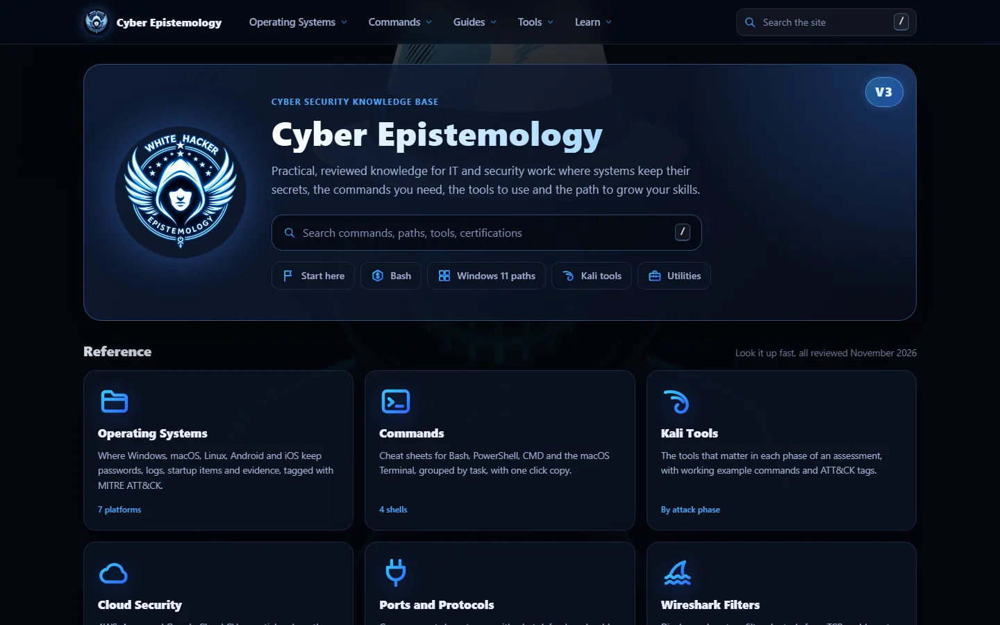
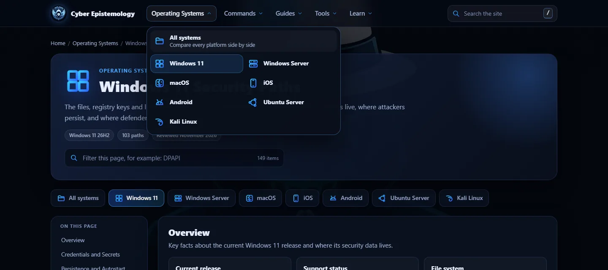
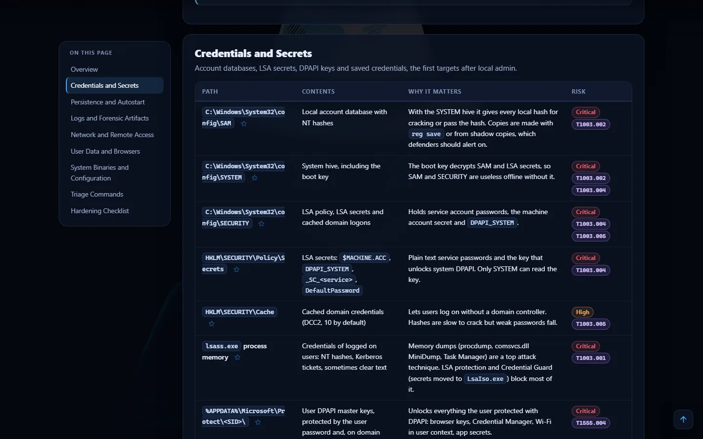
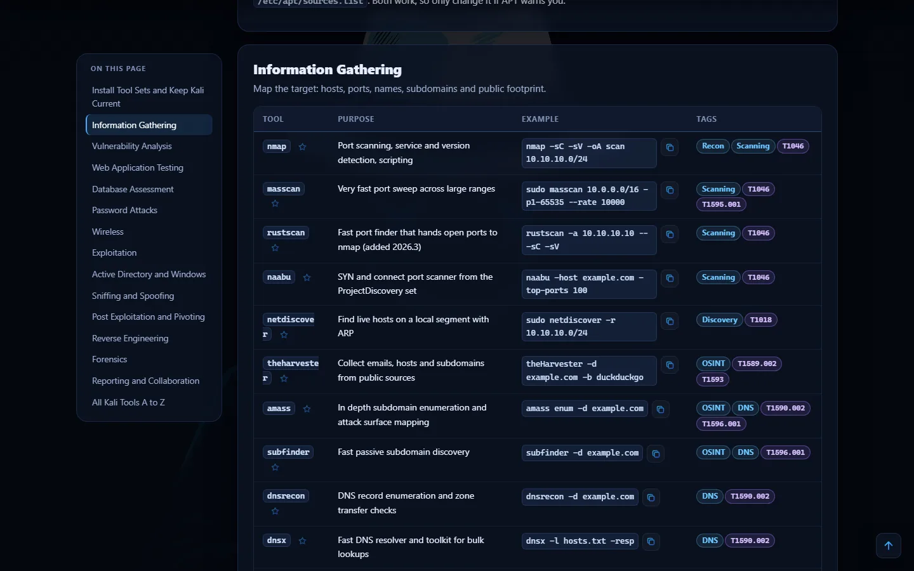
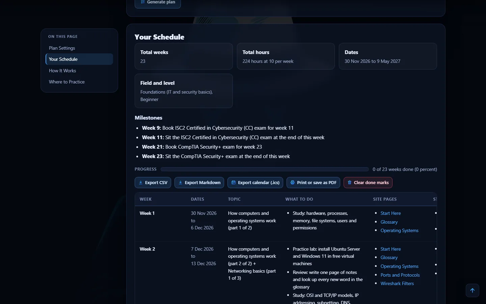
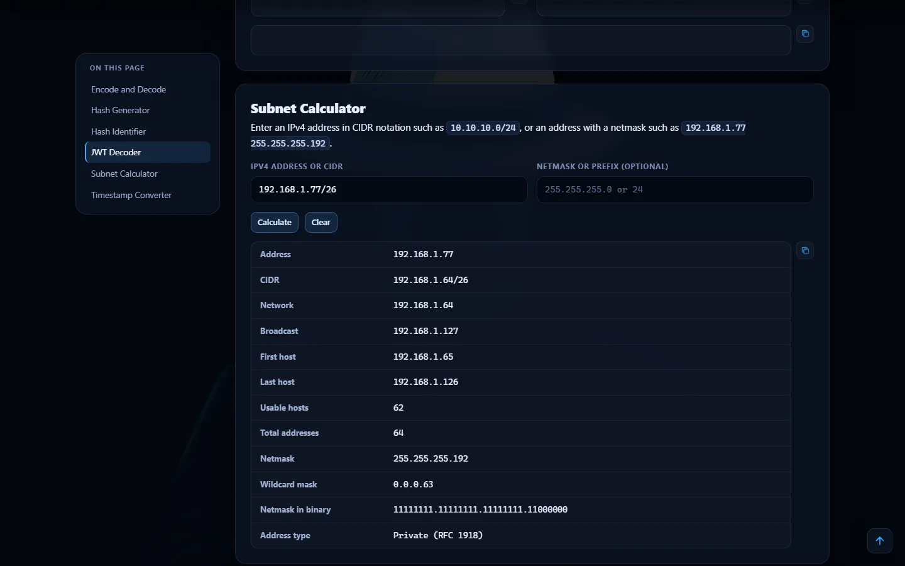
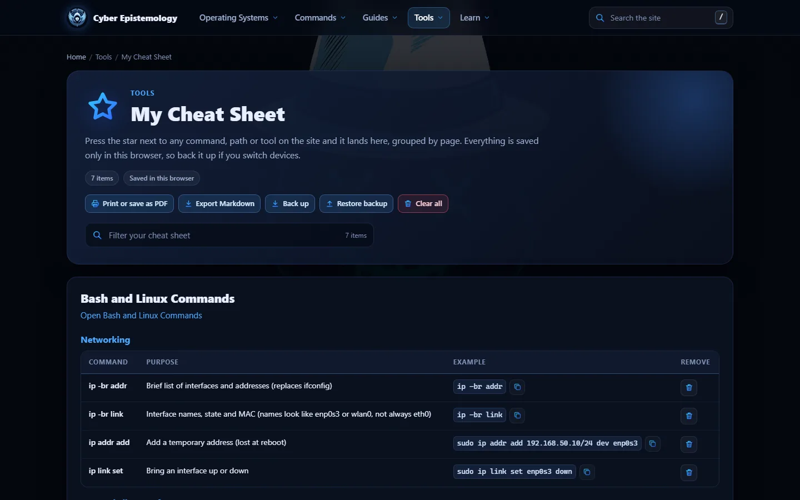
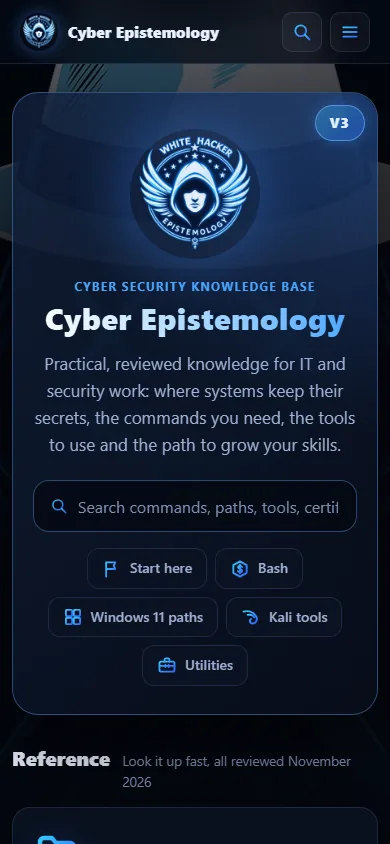
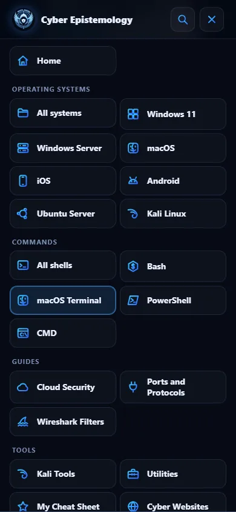

# Cyber Epistemology V3
A free cyber security knowledge base for students, analysts, admins and penetration testers. Plain HTML, CSS and JavaScript with no build step, no frameworks and no online dependencies.
Live site: 
## https://emaldos.github.io/Cyber-Epistemology/

## What is inside
| Section | What you find there |
| --- | --- |
| Operating Systems | Where Windows 11, Windows Server, macOS, iOS, Android, Ubuntu Server and Kali Linux keep passwords, logs, startup items and evidence, tagged with MITRE ATT&CK |
| Commands | Bash, PowerShell, CMD and macOS Terminal cheat sheets grouped by task, plus the same task side by side in each shell |
| Kali Tools | The tools for each phase of an assessment, with example commands and ATT&CK tags |
| Guides | Cloud Security (AWS, Azure, Google Cloud), Ports and Protocols, Wireshark Filters |
| Cyber Websites | Checked links to labs, CTFs, threat intelligence, sandboxes, OSINT and knowledge bases |
| Start Here | Reading paths for beginners, SOC analysts, penetration testers, admins and everyday users |
| Study Planner | A week by week study schedule for 7 fields, with where to study and where to practice (CTFs and labs) |
| Certification Roadmap | Current certifications by career track and level |
| Personal Security | Passwords, passkeys, phishing, updates, backups and what to do after a bad click |
| Glossary | 172 security terms in plain language, each with its own link |
| Utilities | Encode and decode, hash text, identify a hash, decode a JWT, calculate subnets, convert timestamps |
| My Cheat Sheet | Every row you starred across the site on one page |
## Screenshots
| | |
| --- | --- |
|  |  |
| Menus grouped by topic | Security paths with ATT&CK tags |
|  |  |
| Kali tools by phase, star any row | Study planner with milestones and exports |
|  |  |
| Utilities that run in your browser | My cheat sheet, ready to print or export |
### On a phone
 
## Features
- Search the whole site from any page with `/` or `Ctrl K`, and filter any page as you type.
- Star a command, path or tool and it goes to My Cheat Sheet. Print it, export it as Markdown, or back it up and restore it on another device.
- Build a study plan from your field, level, hours per week and start date. Tick weeks as you finish them and export the plan as CSV for Excel, Markdown, a calendar file (.ics) or PDF.
- Works offline after the first visit and can be installed as an app.
- Your stars and study plan stay in your browser. Nothing is sent anywhere, and the utilities never upload what you paste.
## Quick start
1. Download the repository ZIP from GitHub, or clone it.
2. Open `index.html` in your browser.
Opening the files from disk works for everything except offline mode and installing the app, which need a web server. To run one locally:
```bash
git clone https://github.com/emaldos/Cyber-Epistemology.git
cd Cyber-Epistemology
python -m http.server 8080
```
Then open http://localhost:8080/
## Project structure
```
index.html
ServiceWorker.js          offline support
Manifest.webmanifest      app name and icons for installing
Data/                     pages
  Commands/               Bash, PowerShell, CMD, macOS Terminal
  OS/                     one page per operating system
  Guides/                 Cloud Security, Ports and Protocols, Wireshark Filters
Assets/
  Style/                  Site.css plus page styles (Roadmap, Utilities, StudyPlanner)
  Script/Site.js          menus, search, page filter, contents list, copy buttons, stars, offline
  Script/SearchIndex.js   generated search index
  Script/OfflineFiles.js  generated list of files kept for offline use
  Script/                 page scripts (Roadmap, CheatSheet, Utilities, StudyPlanner)
  Icon/                   local SVG icons
  Image/                  logo, favicon, app icons, background
Screenshots/              images used in this README
Tools/
  BuildSearchIndex.py     rebuilds Assets/Script/SearchIndex.js
  BuildOfflineFiles.py    rebuilds Assets/Script/OfflineFiles.js
  CheckSite.py            checks links, anchors, classes and code style
```
## Editing content
1. Copy the structure of an existing page in `Data/`. Every page sets `data-root` (the path back to the root) and `data-section` (which menu is highlighted) on `<body>`.
2. Use the components in `Assets/Style/Site.css`: `panel`, `data-table`, `tag`, `attack-tag`, `callout`, `checklist`, `steps`, `disclosure`, `card-grid`, `definition-grid`. Put commands in `<code class="copy">` to get a copy button. Every table row gets a star button on its own.
3. To add a page to the menus, add it to `navigationGroups` in `Assets/Script/Site.js`.
4. Rebuild the generated files and run the checks:
```bash
python Tools/BuildSearchIndex.py
python Tools/BuildOfflineFiles.py
python Tools/CheckSite.py
```
Run `BuildOfflineFiles.py` after every change so visitors get the new version instead of the copy saved for offline use.
## Code style
No blank lines, no comments, one CSS rule per line, HTML, CSS and JS in separate files, local assets only, and no em dash or en dash characters.
## License
GNU General Public License v3.0. See `LICENSE`.
